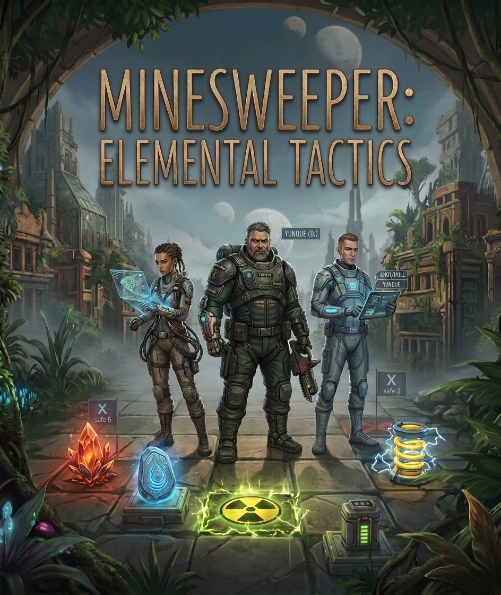
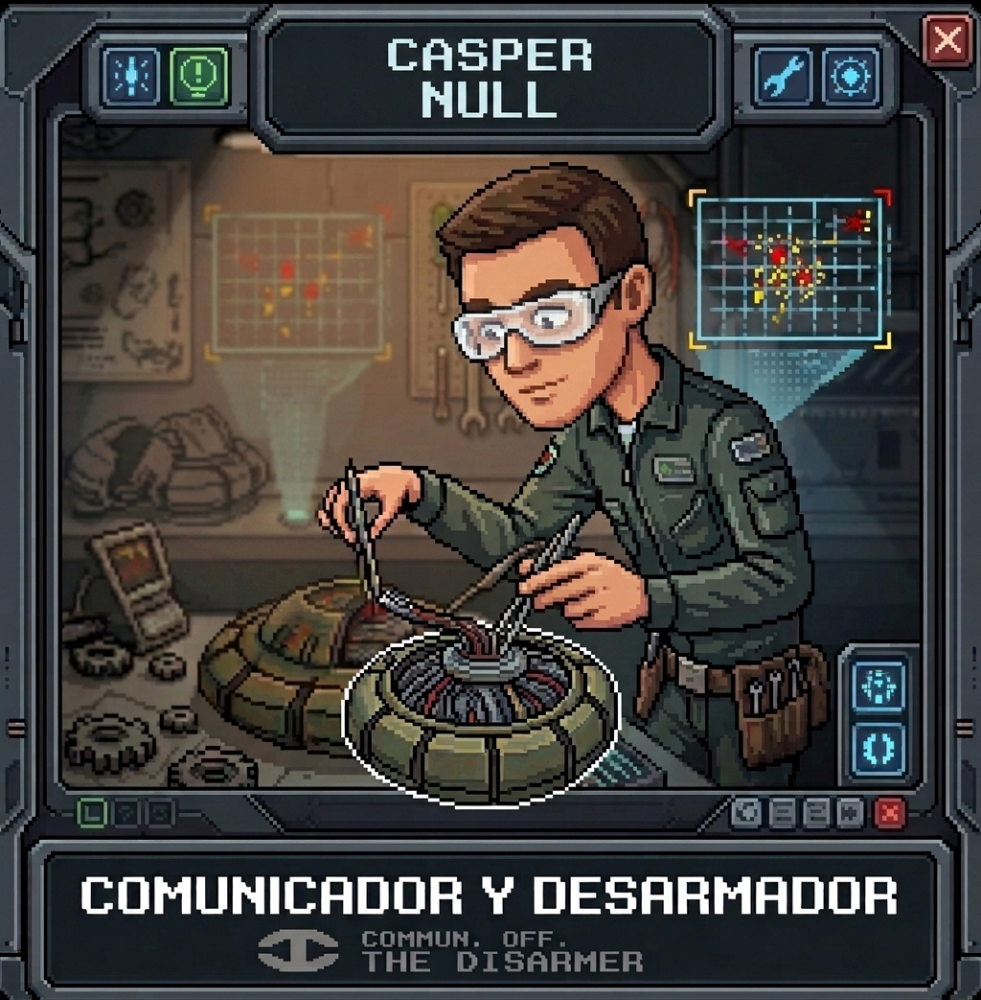
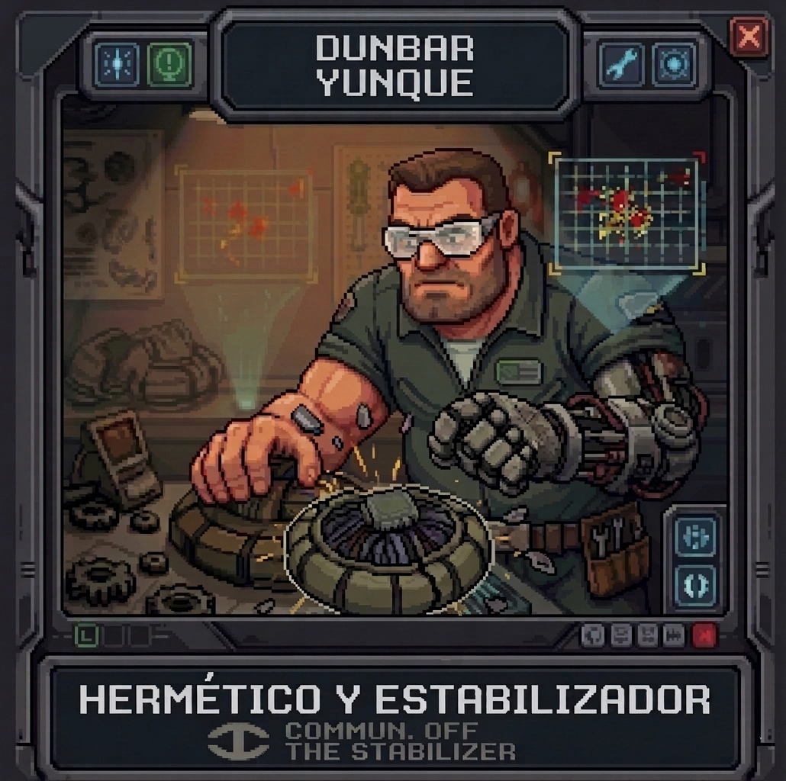
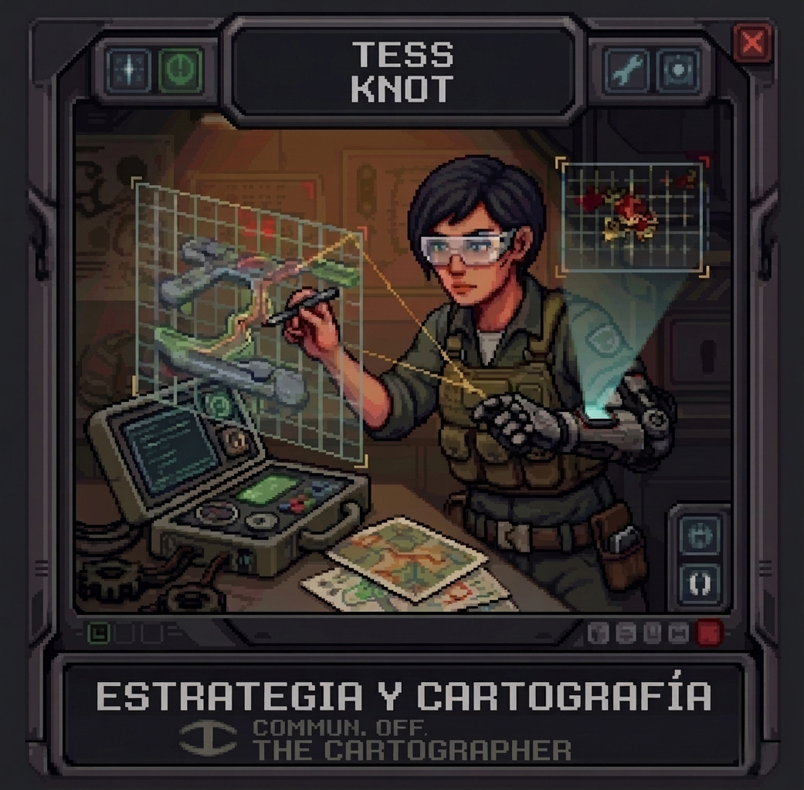
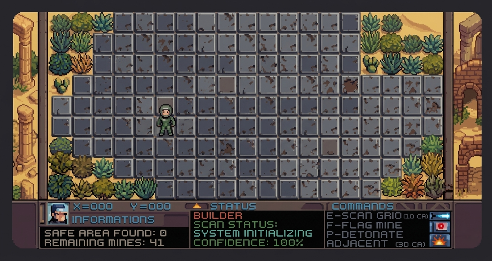
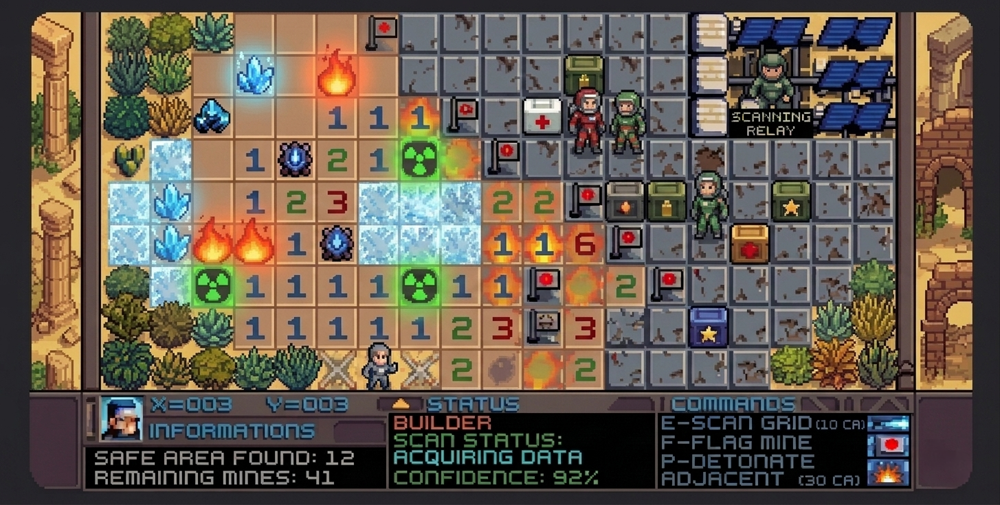
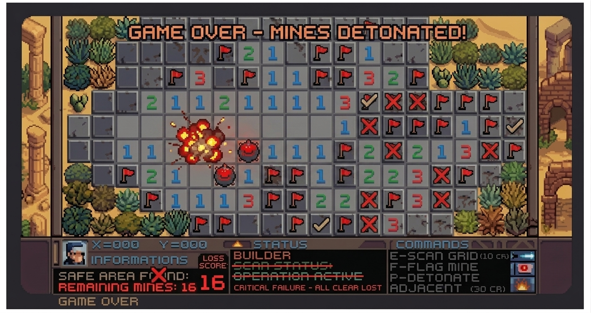
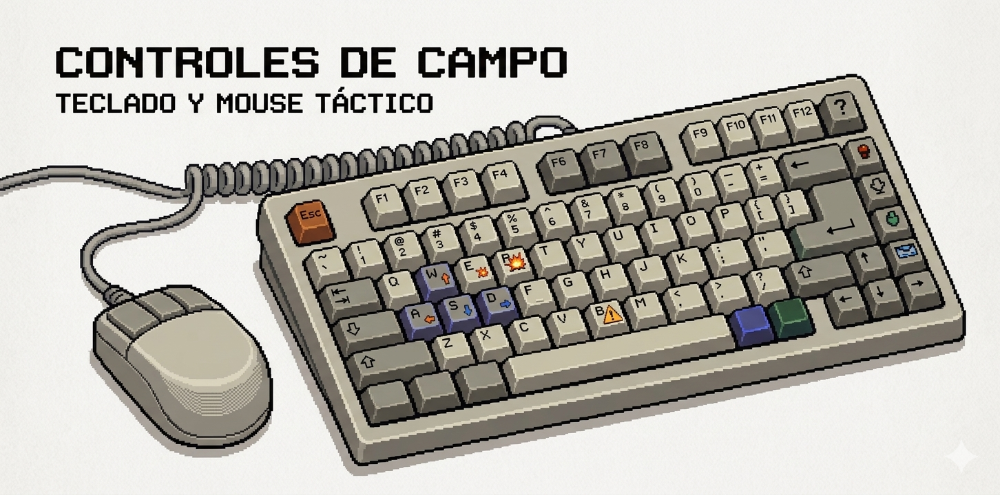
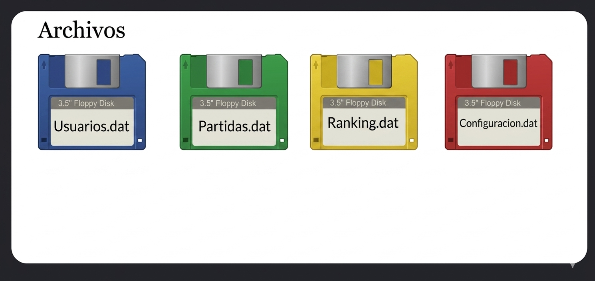
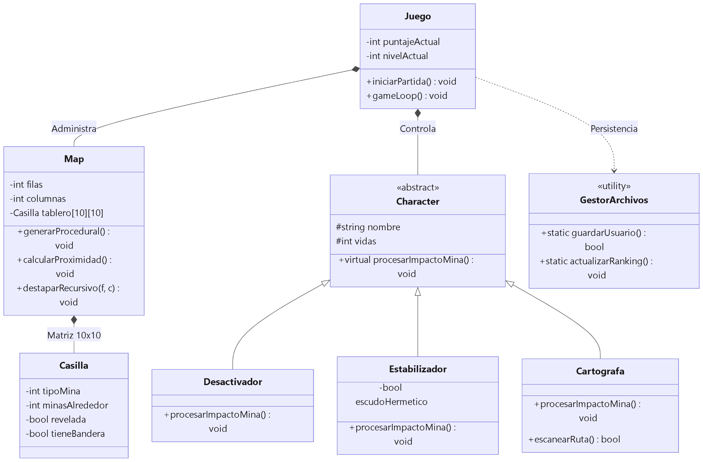

# MINESWEEPER: ELEMENTAL TACTICS

  

**Minesweeper: Elemental Tactics** es un juego de supervivencia táctica sobre un tablero dinámico inspirado en una ciudad perdida y desconocida del planeta.

## Historia

Año 2026. Tras el colapso ambiental de varios ecosistemas vitales, la Corporación NeoTerra ha identificado una ciudad perdida y desconocida en un área altamente inestable del planeta, rica en recursos, pero cubierta por un campo minado elemental. Esta zona, conocida sólo como **“El Sector Cero”**, ha sido infestada por anomalías energéticas que se manifiestan como minas volátiles de origen elemental.

### La misión del jugador: Ingenieros Tácticos Terrestres

Como miembro de la unidad de élite **Element-Defuse**, tu misión principal es el **“Protocolo de Reclamación”**: limpiar metódicamente los cuadrantes sector por sector (niveles de dificultad) para alcanzar y estabilizar el Núcleo de Energía en el centro del Sector Cero. Solo con la neutralización total se permitirá la exploración segura del territorio y su posterior explotación y colonización.

Cada ingeniero posee una virtud táctica esencial para la supervivencia, y la correcta utilización de estas virtudes es fundamental al elegir el personaje deseado.

El éxito depende de la coordinación y de la gestión inteligente del riesgo en un entorno donde cada paso es una decisión de vida o muerte.

## Personajes

Cada personaje ofrece habilidades y limitaciones tácticas diferentes.

### Casper Null

  

Especialista en desactivación quirúrgica de explosivos y análisis de señales de baja frecuencia. Posee la capacidad de identificar y desarmar minas con información incompleta. Si una mina de radiación intenta alterar los números vecinos mostrando información falsa, la habilidad pasiva de Casper contrarresta el efecto filtrando el engaño y mostrando el valor numérico real de proximidad.

Adicionalmente, cuenta con un intento de desactivación segura por nivel: si coloca una bandera en una casilla incorrecta, el sistema no penaliza su puntaje de forma inmediata.

Al utilizar trajes ligeros para maximizar su precisión manual, su resistencia física es mínima. Cuenta con 1 vida inicial menos en la estructura de la partida y si activa accidentalmente una Mina de Fuego, el daño en el área de 3x3 destruye su equipamiento provocando un Game Over instantáneo.

### Dunbar Yunque

  

Ingeniero de asalto pesado y especialista en contención de ondas expansivas. Capacidad extrema para mitigar el daño por detonaciones cercanas. Al iniciar la partida, si el usuario revela una casilla con una mina común o ingresa al cuadrante de una Mina de Fuego, el escudo absorbe el 100% del impacto; la mina se muestra descubierta en el tablero pero el jugador sobrevive sin restar vidas de su contador.

Posee además inmunidad pasiva a la congelación de las Minas de Hielo. Su armadura pesada ralentiza drásticamente sus acciones bajo reloj. El tiempo límite de la partida se reduce en un 25% al jugar con Dunbar.

Adicionalmente, debido a su tosquedad táctica, cada vez que coloca una bandera gasta un “crédito de herramientas”, reduciendo su puntaje final del ranking en un multiplicador fijo por cada movimiento en falso.

### Tess Knot

  

Estratega de campo y analista de rutas óptimas sobre terrenos inestables. Destreza analítica para prever la dinámica del tablero y planificar rutas de limpieza que minimizan el riesgo de reacciones en cadena. Activa un subproceso de escaneo que evalúa si las casillas vacías contiguas conectan de forma adyacente con una mina elemental inestable. Si detecta peligro de reacción en cadena masiva, el cursor destella en la consola advirtiendo al jugador sobre la ruta peligrosa para que pueda recalcular su movimiento.

Carece de herramientas de desactivación directa o blindaje físico. Si Tess activa una mina convencional, resta 2 vidas directamente del contador. No posee inmunidad a ningún estado elemental (puede ser congelada o engañada por la radiación) y su algoritmo de mapeo consume recursos de energía del tablero, lo que obliga al jugador a esperar un tiempo de recarga de 5 turnos entre escaneos activos.

## Mecánica del juego

Minesweeper: Elemental Tactics se desarrolla sobre un tablero dinámico. Al iniciar la partida, el Ingeniero Táctico Terrestre seleccionado aparece en la coordenada base **(Y=0, X=0)** del mapa, cuyas casillas se configuran con una distribución aleatoria y única de amenazas en cada nueva sesión. El objetivo inmediato del jugador es moverse a una casilla adyacente para revelar su contenido. Este movimiento inicial activa el despliegue de las amenazas elementales y marca el comienzo del Protocolo de Reclamación.

  

A partir de este despliegue de amenazas en el subsuelo, la interfaz revela los sensores numéricos de proximidad (valores del 1 al 8), que indican cuántas amenazas rodean el perímetro del cuadrante. Tus alternativas de supervivencia dependen exclusivamente de cómo interpretes estos datos para avanzar sobre el terreno sin activar los depósitos volátiles de la ciudad perdida.

Las condiciones geológicas de esta ciudad no son pasivas; el terreno esconde trampas inestables que desatan reacciones en cadena. Las **Minas de Fuego** estallan incinerando un cuadrante de 3x3 y bloqueando tus rutas por varios turnos; las **Minas de Hielo** congelan tus sistemas ralentizando tus acciones y haciendo que el cronómetro corra al doble de velocidad; y las **Minas de Radiación** sabotean tus radares alterando los números adyacentes para mostrar información falsa y forzarte al error. Nada que una selección inteligente de tu rol de ingeniero y el uso estratégico de los contenedores de Power-ups no puedan contrarrestar.

  

Pasados los primeros cuadrantes de exploración, la dificultad aumentará drásticamente en los niveles avanzados de la campaña. Las amenazas comunes serán reemplazadas por densas redes de minas elementales consecutivas bajo un reloj que presiona de forma implacable. Aquí será el momento de trabajar en equipo con las habilidades únicas de los operadores: la inmunidad y fuerza de Dunbar Yunque, la precisión de filtrado de datos de Casper Null, o el escaneo predictivo de mapas holográficos de Tess Knot.

La victoria táctica se alcanza cuando todas las zonas seguras del mapa son reveladas con éxito; el sistema calcula tu puntaje final combinando el tiempo remanente con las bonificaciones del nivel e inscribe tu marca en el Top 5 histórico de los pioneros. Por el contrario, la derrota en campaña se suscita cuando el cronómetro general expira o cuando las detonaciones agotan por completo los vectores de vitalidad del ingeniero.

  

Tu estrategia de exploración será clave para subsistir. El usuario no debe avanzar al azar; debe utilizar un método deductivo estricto, aislando primero los patrones numéricos seguros en los bordes del mapa y canalizando la energía acumulada para activar el escaneo de radar en las zonas de mayor incertidumbre. Aprovechar las debilidades y virtudes de cada ingeniero en base a la inestable geografía del tablero elemental será fundamental para vencer la hostilidad de esta ciudad y asegurar la supervivencia de los operarios.

## Controles

Los controles se utilizan desde una consola de texto, mediante el teclado y el cursor táctico. Posicionate sobre la casilla deseada y utilizá la tecla correspondiente para realizar una acción.

  

| Tecla | Acción |
|---|---|
| `R` | Revelar el contenido de la casilla seleccionada. |
| `B` | Colocar una bandera de advertencia sobre una posible mina. |
| `E` | Activar un escaneo de radar predictivo, según la descripción del proyecto. |

## Persistencia de datos

El programa utilizará archivos de datos binarios (`.dat`) para almacenar el estado de la partida, el historial de los usuarios y las métricas competitivas, permitiendo conservar los avances entre diferentes sesiones de ejecución.

A diferencia de los sistemas lineales simples, existirá un ecosistema relacional compuesto por cuatro archivos independientes para que varias personas puedan registrarse a la vez, jugar de forma aislada y competir en un ranking unificado.

  

- **`Usuarios.dat`:** almacena los perfiles individuales de los operadores, resguardando su identificador único (`idUsuario`), credenciales de acceso y el historial acumulado de misiones totales y ganadas.
- **`Partidas.dat`:** registra el log histórico de cada despliegue táctico. Vincula de forma relacional el usuario con la configuración del mapa, el tiempo de respuesta empleado y el resultado analítico de la misión (victoria o derrota).
- **`Ranking.dat`:** centraliza las marcas competitivas de élite, filtrando y ordenando las puntuaciones más altas y los mejores tiempos segmentados por el nivel de dificultad alcanzado en la campaña.
- **`Configuracion.dat`:** almacena preferencias del entorno táctico, como la escala geométrica del mapa (cantidad de filas y columnas), la densidad de amenazas, los patrones de color de la interfaz de consola y los modificadores de estado del terreno.

## Diagrama de clases

  

## Nota de autoría y propiedad intelectual

Minesweeper: Elemental Tactics es un software original desarrollado en 2026 por estudiantes de la Tecnicatura Superior en Programación. El presente informe técnico incorpora material visual conceptual generado mediante herramientas de Inteligencia Artificial. Los nombres, ilustraciones y recursos gráficos constituyen propiedad intelectual de sus respectivos autores. La narrativa de la “ciudad perdida”, las mecánicas elementales y los sistemas derivados son de autoría exclusiva del equipo de desarrollo, utilizando como base algorítmica las reglas lógicas del clásico y reconocido videojuego Minesweeper (Buscaminas).
